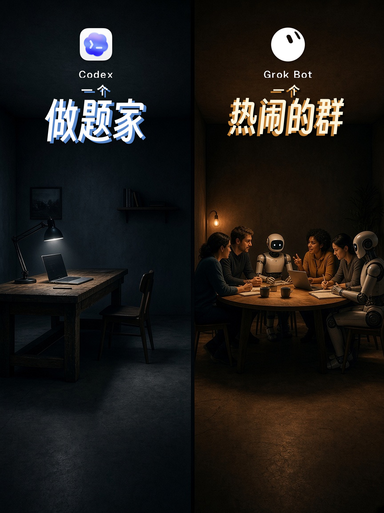

> 每月400刀同时喂给Codex和Grok Bot。一个闷头做题，一个热闹开群；高档位不耐烧，多人协作却常停在广播。

这段时间我把 Codex（包括它的 Dot）和 Grok Bot 都拉到了 200 美元档，两边换着花样往死里用。每个月 400 美金砸下去，最先感受到的根本不是谁在榜单上多拿几分，而是这两套东西从骨子里就没打算做成同一种工具。

## Codex 是好老师傅，活拆不清就会自己加戏

先说 Codex。用起来像请了一个闷头干活的老师傅——模型透明，用哪个型号、开多大推理档位，全摆在明面上让你自己拧。

如果我事先把活拆得够细，边界划得清清楚楚，Codex 的执行力确实硬。改代码、盯仓库、顺着既定轨道往下凿，很少掉链子。问题在于人懒的时候，想把整个大 Goal 一股脑甩给它。它倒是真敢接，也会照着做，但跑着跑着就容易在半路拐进某个没必要死磕的角落，自顾自加戏，白白烧掉一大截力气。

至于它的多线程，说白了还是“你自己把一件事剁成几块，开几个窗口让它分别跑”。各干各的，互不打扰，谈不上协作。

## 高档位一拧，200 刀说没就没

更现实的是花钱速度。Codex 给你留足了选择权，但也把“烧穿额度”的开关交给了你自己。平常开普通档位还好，可一旦顺手切到 GPT-6 Astra，再把档位推到 Max 甚至 Ultra，后台 token 就像开了闸一样哐哐往下掉，200 刀的池子没几下就见底了。爽是真爽，不耐烧也是真不耐烧。

## Grok Bot 更顺，也更耐花

换到 Grok Bot，画风完全变了。

第一体感是顺。不用挂 VPN，在外面网络抽风或者手机上切来切去时，少了一层折腾，体验直接拉高一截。响应也快，多个任务一起往前拱，而且后台偶尔给你路由到更顶的模型，用起来有种“突然抽到隐藏款”的赚感。算下来同样干一天的活，Grok Bot 的 200 刀明显更耐花——它不让你天天拧模型和档位，省了操心，也替你兜住了预算。

## 协作的问题不是人多，是先广播再静音

但如果聊到它最爱讲的“多 Agent 协作”，老实说，我现在一半觉得好用，一半觉得挺像噱头。

群里丢一句话，经常好几个 Agent 一起抢答；哪怕我专门 @ 了某一个，旁边那几位还是忍不住冒出来搭两句。后来我干脆在群里设了个总指挥，想着这下总有秩序了吧？结果一看机制，背后多半还是所有人先各自思考、生成一轮，再由没轮到发言的几个自己判断“我不该说”，最后把嘴闭上。表面上看是安静了，账单上的 token 其实一分没少扣。

再看这帮 Agent 在项目组里互相传话的状态：有时候明明一两句结构化数据就能交代完的事，它们要在聊天框里来回打好几个回合，信息密度低得让人着急；偏偏聊到后面，它们自己倒摸索出一套外人看不懂的“黑话”来压缩表达。看着挺乐，反过来也说明，让一群 Agent 靠“聊天”来协作，通道本身就不够划算。

## 一边把方向盘交给你，一边想把现场搭起来

两个 200 刀交完学费，其实能看出两边团队对 Agent 的想象不在一个频道上。Codex 骨子里还是单兵执行器，信奉把选择权和单步质量交给用户，代价是你要自己做拆解、自己管预算；Grok Bot 押的是“协作现场”，想让一群角色同时在线推进，只是目前很多调度还停留在“广播后再静音”，远没到真正按分工按需唤醒的程度。

所以我现在用法也很简单：目标明确、想一次抠对的工程活，丢给 Codex，老老实实控好档位；需要同时盯几条线、随时插手改方向的活，才拉进 Grok Bot 的现场里跑。至于以后谁能先把“多 Agent 别靠瞎聊天传状态”以及“高强度下不烧穿钱包”这两件事磨顺了，大概才算真正摸到下一代工具的门。
