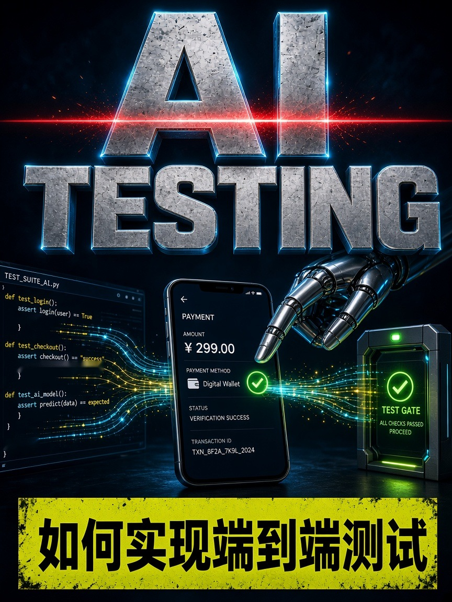

> AI写代码快了，测试卡在端到端。概念对齐、Codex当运行时、Ontology沉淀业务知识、Skill稳住真机执行。

现在很常见的一幕：需求下午提出来，Codex 晚上就把 PR 推上来了，单测也顺手补齐。可测试那头的排期，还是按天算。

这一年我最直接的感受是：AI 写代码的速度把整条研发流水线拉偏了。开发不再是最慢的那一环，压力一下子全堆到测试上。PR 越合越多，回归越跑越久，测试的人手没变。

测试这头也分两半。后端那一半，AI 已经做得相当顺了：接口、规则、批处理，入参出参都是结构化的，读完代码和接口定义就能写断言、造请求、跑回归，基本看不到明显的边界。难的是前端那一半，尤其是功能层面的端到端测试。我们现在能做到的，是在一部分需求上从用例到执行跑通，可它是半自动的：开头输出用例要人补业务信息，执行过程中要人盯着、在卡住的地方搭把手。

离真正的端到端还差什么，卡在哪几个点上，我想借这篇一个个拆开讲。

## 生成用例最便宜，铺不完的场景才是 AI 该接的活

最早大家想象的 AI 测试，就是把需求丢给模型，吐出一堆用例。这一步确实最便宜，几分钟出几十条，格式工整。可用例写完只是开始，跑不跑得起来、跑在哪、跑挂了算谁的，它都不管。

我算账的方式是看哪类活人最不愿意干。答案很清楚：边界场景和兼容覆盖。

拿一个最普通的下单流程举例。主路径人点一遍十分钟。可同一个流程要在 iOS 和安卓的几档系统版本上各走一遍，要在 App 里走、在微信小程序里走、在 H5 里走，再叠上未登录、登录态过期、弱网、重复提交、中途切后台几种状态。维度一乘，几百个组合。人来做，第一遍还认真，第三遍就开始跳步，第五遍漏掉的往往就是线上出事的那一条。这种活又累又容易错，没人愿意做，也做不好。

我们真正想交给 AI 的就是这一层：把人铺不完、也不想铺的场景铺满。所以落点自然落到端到端上，因为这些组合只有在真实的端上、真实的业务路径里跑才算数。

## 概念对不齐，后面每一步都在各说各话

真动手之前，第一个卡住我们的不是技术，是概念。

单元测试、集成测试、功能测试、自动化测试，开会时经常被混成一个词用。一个人说「端到端覆盖不够」，另一个人理解成「自动化率不够」，第三个人想的是「单测没写」。讨论半小时，各自回去做的不是同一件事。

所以我们先把概念对齐：单元测试看一个函数、一个组件的逻辑对不对，在开发阶段兜底；集成测试看模块之间、前后端之间接起来通不通；功能测试看业务需求有没有被实现，跟业务强绑定；自动化测试说的是执行方式，跟测哪一层无关。拿「投保、支付、出单」这条链跑一次脚本回归，它同时是端到端、功能测试和自动化测试，这三个词描述的是不同的维度，谁也不包含谁。

概念对齐之后，第二件事是说清楚测什么。功能维度跟业务强相关，大家都会盯。安全、兼容、性能这三块特别容易被忽略：需求评审里没人提，提测时没人测，可一上线，越权、某个机型白屏、高峰期接口超时，一样变成要连夜处理的线上问题。

把这两件事放在一起看，AI 的杠杆在哪就清楚了。功能维度里，主路径人能测，AI 的价值在把边界和异常补全。兼容维度是 AI 杠杆最高的地方，因为它纯靠组合数取胜，规则明确，人最不愿意做。安全和性能已经有成熟引擎，AI 负责挑场景、调度工具、解读结果，具体测量还是交给引擎。

## 自建 Agent 不划算，运行时直接借 Codex

要让 AI 自己去测，先得有一个能干活的主体，也就是 Agent 的运行时。

最直接的路是拿模型 API 自己搭一个：写调度循环、管上下文、接工具、做权限和沙箱、处理断线重试。能做，但很重。光是让它稳定地读代码、跑命令、在长任务里不丢上下文，就够一个小团队折腾几个月，Token 费用还要单独算。

我最后选的是 Codex 插件这条路。团队本来就在用 Codex 写方案、看代码、跑命令，运行时、沙箱、审批这些它都已经做好了，额度直接走 Codex 订阅。测试能力做成插件挂上去，人在同一个工作界面里从写代码切到测代码，上下文不用搬家。省下来的精力全部投到真正难的那几块上。

## AI 能写用例，写不出业务跑在哪、险在哪

运行时有了，下一步是让 AI 从需求里自己看懂要测什么：测试范围有多大，走哪几条路径，要点在哪，最后输出用例。

这一步现在能做到一半。把需求文档、技术方案喂进去，再给几句提示，它能出一份像样的用例清单，结构比很多人手写的还完整。

缺的那一半是业务判断。我试过好几次，同一份需求，它不知道这个业务除了 App 还跑在小程序上；不知道这个入口每天的流量有多大，哪条路径挂了是事故、哪条挂了没人发现；也不知道改了支付页，退款那条老链路会不会被带着出问题。这些信息需求文档里通常不写，是做这个业务的人脑子里默认的东西。所以现在的模式是人在开头补一句「这个还要跑小程序」「注意老用户的升级路径」，它再改一版。

这就是半自动的根源。AI 对业务、对流量、对业务流程的判断是缺失的，而这恰恰是我们最需要补上的那块知识。

## 业务知识要跟着每个需求一起长

AI 一旦知道业务是什么，用例质量会明显上一个台阶：它会自己想到要测哪几个端，会把高流量路径排在前面，输出的用例也能直接拿去执行，不用人再改一遍。

关键在知识库怎么建。我们没有用把文档切块塞进向量库的做法，因为业务知识最重要的是关系：哪个产品有哪些入口，哪个入口通向哪条流程，这条流程跑在哪些端、依赖哪种账号状态。这些关系一旦散在文档片段里，检索出来就是一堆不连贯的句子。

所以我们用 Ontology 的思路做抽象：把业务概念、流程、页面入口、端和系统环境定义成实体，把它们之间的关系定义清楚，用例和报告只引用这些实体。证据也分级，文档里写明的、从代码推出来的、人口头说的分开标，口头的先标「待对齐」，不直接进知识库。

知识库不是一次建完的。先做初始化，把现有业务梳一遍；之后每跑一个需求，新发现的入口、新踩的坑、人在开头补的那句话，都要回写进去。下一个需求再来，AI 就不用再问同一个问题。人每补一次，知识库就厚一点，人需要介入的地方也就少一点，这是半自动往自动走唯一靠谱的路。

## 执行难在稳定、进场和数据，点击反而最简单

有了用例，下一个问题是怎么跑。我们要求它在真机、模拟器和网页三类环境上都能跑。

连接方式用的都是各平台的主流方案。安卓走 ADB，配合 UIAutomator2 取控件树、做点击滑动；iOS 用 XCUITest，通过 WebDriverAgent 把操作暴露出来；鸿蒙走 hdc 连接设备，用官方测试套件里的 UiTest 框架做控件查找和操作；网页用 Playwright；微信小程序可以借官方的 miniprogram-automator，通过开发者工具驱动。这一层大家的方案大同小异，真正拉开差距的是下面三件事。

第一是稳定性。真机最真实，也最娇气：数据线松一下、电脑休眠一下、系统弹个升级提示，任务就断了。鸿蒙的无线调试我们吃过不少亏，设备列表说空就空，得亮屏重新打开。所以除了把真机连接本身做稳，更重要的是让 AI 自己判断这一次该用哪一档。网页直接测成本最低、速度最快，但它模拟的移动端和真机差得远，键盘弹起、系统权限弹窗、App 容器里的行为都测不到。纯逻辑校验走网页，交互和兼容走模拟器，涉及支付、推送、系统权限的必须上真机。结论只算实际跑到的那一档，降级了，要求不能跟着降。

第二是环境构造，也就是怎么真正进到业务里。拿到一台手机，AI 得知道打开哪个 App、从哪个入口进、要测的是 App 还是小程序还是内嵌 H5、中间要过几个引导页。这些不能靠它每次现场摸索，摸一次十几分钟，还经常摸进测试包或者自测入口里。这些路径必须提前写进业务知识里，执行时直接按图走。

第三是数据构造。进了业务之后，账号对不对是另一道关。要测退保，账号里得先有一张能走到退保的保单；要测老用户升级，得有一个刚好处在旧版本状态的账号。数据不对，路径点得再顺，测到的也只是主路。所以要有一套数据构造能力，按场景造出合法的账号和前置状态，测完还要清理。这块很多大厂内部其实早有积累，各种造数平台、场景构造工具都有，直接以工具的形式接进来就行，没必要重新造。

## 测试报告应该长在对话里

最后一环是结果怎么呈现。

传统测试报告是一份 HTML 或者一张表格：多少条通过、多少条失败、附几张截图。放在 AI 测试里不够用，因为人看报告时最常问的是「这条为什么挂」「是代码的问题还是用例的问题」「帮我重跑这三条」，而 Agent 就在旁边，能直接回答、直接动手。

Codex 插件里的 MCP Server 可以带自定义 UI，这套机制基于开放的 MCP Apps 标准：工具调用返回一个界面组件，直接以卡片的形式嵌在对话里，也能展开成全屏视图，组件里点一下就能回调插件的工具。我们用它做测试报告：失败用例按端和路径分组展示，每条附截图、控件树和失败归因，点「重跑」直接触发执行，点「标记为用例问题」直接回写知识库。报告从一份要人读完再去操作的文档，变成了一个能在对话里接着干活的界面。

## 半自动到自动，差的是业务知识

回头看这一整套，能解决端到端问题的从来不是哪个模型点屏幕点得更准，而是三层东西各就各位。

最上面是业务知识。业务概念、业务跑的路径和流程，以及这个业务该测的环境维度，比如跑在哪些端、哪些 App、哪些系统版本，都在知识库里用 Ontology 建好，并且跟着每个需求持续更新。AI 理解了业务，才能自己判断测什么、在哪测。

中间是端上执行。真机、模拟器、网页的连接、进场和数据构造，都沉淀成稳定的 Skill，每次调用行为一致，不靠模型临场发挥。

最下面是运行时。Agent 跑在 Codex 里，用现成的沙箱、审批和订阅额度。

这三层最后打包成一个插件交付：装上就有业务知识、端上执行和对话里的报告，测试的人和写代码的人用同一个入口。

到今天，这套东西在一部分需求上已经能从用例跑到执行，开头和过程中仍然需要人补业务、盯关键步骤，离全自动还有距离。我的判断是，这段距离的大头不在执行技术上，在业务知识还不够厚。每补一次知识，下一次就少问一句；等到 AI 不再需要人提醒「这个还要跑小程序」的那天，端到端才算真正交到它手里。
