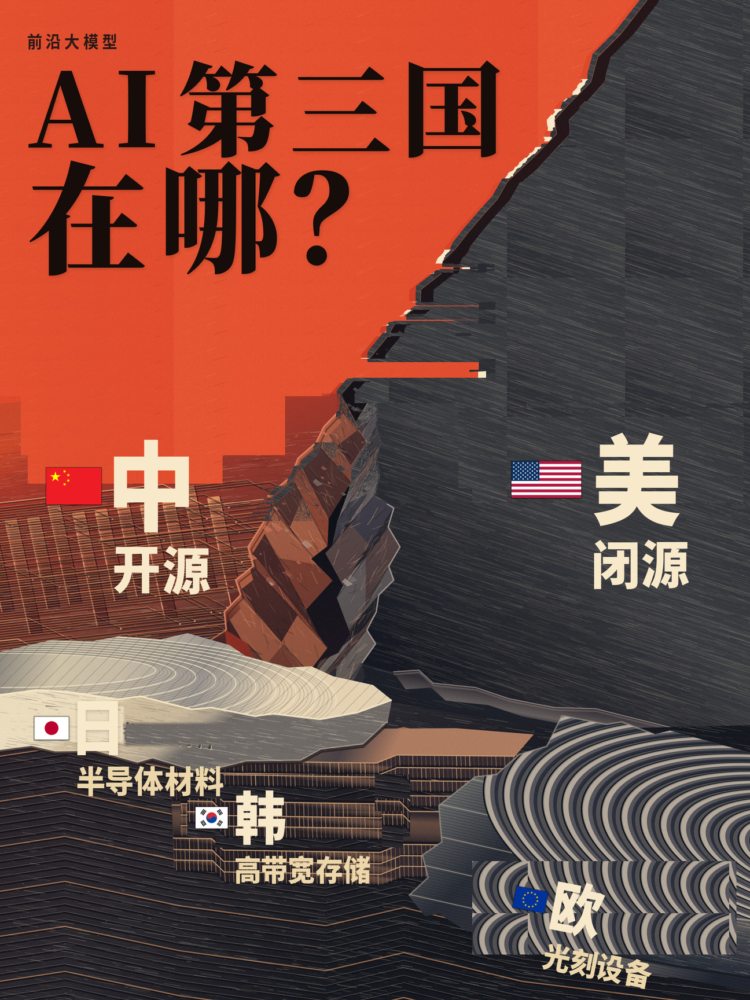

> 中美之外不是没人做AI：有的守住芯片关口，有的当机房房东，有的直接用开源，榜上才找不出第三国。

有个奇怪的现象，时至今日，大模型榜上除了中美，还能找出第三个国家吗？其他国家都不发展AI吗？AI这么强，他们不需要？

这个月中旬，我把 Artificial Analysis 的综合榜从第一名往下数到第二十五名，国旗只有两种：美国 16 个，中国 9 个。头名是 Anthropic 的 Claude Fable 5.2，64.6 分；中国最好的是 Kimi K3.1 Pro，46.5 分。中美之外分数最高的是法国 Mistral Large 4，26 分出头，前二十五没摸到边。

拿这个问身边的人，答案来得很快：法国有 Mistral，英国有 DeepMind，韩国也在搞，中东不是有钱吗。每个答案都沾点边。可一个个往下查，味道就变了。

## 被喊出来的“第三名”，户口大多落在别处

先说英国。论花钱，英国确实排得上号：2025 年私人 AI 投资 59 亿美元，排在美国 2859 亿、中国 124 亿之后。可一提英国大模型，大家脑子里冒出来的是 DeepMind。实验室在伦敦，老板是谷歌，模型署的是 Google 的名。英国政府自己今年要建的基础研究实验室，六年最多 4000 万英镑，做科研补强够用，练前沿模型差得远。

中东的画面更唬人。阿布扎比在建吉瓦级的 Stargate，楼是当地盖的，运营的是 OpenAI 和 Oracle，里面跑的主要是美国模型。沙特那边更直白，自家的阿拉伯语旗舰 humain-m3，新闻稿上写得清清楚楚：HUMAIN 委托，MiniMax 交付。钱是沙特的，模型是中国团队做的。

韩国稍微复杂一点。按 2025 年“有分量的模型”产量，它排第三：美国 59 个，中国 35 个，韩国 8 个。数量是真的，可这个月能查到的独立复测里，韩国最好的还是 K-EXAONE 2.0，7.6 分。新版本号称能跟中国开源掰手腕，目前还只是厂商自己说的。新加坡也得留个心眼，本地语言项目确实在做，但不少中国实验室的海外主体也注册在那儿，注册地和训练地是两回事。

一圈查下来，像在查户口：人在这个国家，户口落在别人家。投资第三、产量第三、机房第三，都很容易被顺嘴说成大模型第三。

## 真下场练的，也只爬到半山腰

把这些挪开，还真有人老老实实在练，最像样的是法国。

Mistral 今年 9 月一轮融了 30 亿欧元，估值超过 210 亿欧元，用大约 3800 张高端 GPU 从零练出开放权重的大模型。放在欧洲，这已经是科技史上数得着的大钱。可它的 26 分，前面隔着中国开源的 30 多分，再往前是美国闭源的 60 分上下。

分数还不是最扎心的。今年 8 月，Mistral 开始给客户提供第三方模型，第一个上架的是中国的 GLM。欧洲最能打的模型公司，开始帮着卖中国模型了。

所以别说欧洲啥都没有。光刻机在荷兰，芯片架构在英国的 ARM，Mistral 也是真实验室。欧洲缺的是把电、钱、芯片、云一层层叠起来，最后叠出一个能上桌的基础模型。英国、德国的钱和人，常常流进美国公司的研究部门；德国最有名的通用模型公司，正在并进一家加拿大企业。手里有好牌，就是凑不成一手能打的。

## 日韩荷压根没打算在这张榜上争

有几个国家，在模型上没下那种死力气，是因为他们站在更下面的位置，而且站得很稳。

一张训练卡要出生，绕不开几道工序：最先进的晶圆代工，把显存一层层摞起来的高带宽内存，还有极紫外光刻。全球领先的 AI 芯片几乎都要送进同一家代工厂；高带宽内存，韩国掐着训练集群的脖子；材料、设备和一部分先进封装，日本到现在也很难绕开；光刻机，荷兰一家独大。

中美越往上堆训练，他们的单子越多。这生意挣得比上榜踏实。

日韩的互联网和电子工业都很成熟，只是本国语言市场小，大公司更愿意把硬件卖给练模型的人，再引进、精调几个本国模型自己用。韩国两头都在做，但存储是真门槛，模型还在追。门槛握在手里的时候，犯不着拿一张进不去前二十五的榜，来证明自己没掉队。

## 机房盖在你家，模型不一定姓你

还有一种很容易看走眼：地上有机房，就以为地上有模型。

练模型和跑模型，要的是能调度起来的算力，网络、存储、集群软件、数据管道都得配齐，光有一栋制冷良好的大楼没用。美国强在云和模型本来就长在一套体系里；中国有自己的云，才能在自己的地上一遍遍预训练。别的地方的机房，很多是把美国或中国的模型搬过来跑推理，要么把训练任务租到别人的云上。

阿布扎比的集群就是这样，电和地是海湾的，运营和模型可以还是美国公司的。德国数据中心的数量在全球统计里很靠前，可机房数量不等于训练能力，更不等于原创前沿。加拿大最有名的企业模型公司总部在多伦多，算力却长期靠美国云，政府入股的条件之一，就是把基础设施搬回本国。

电也一样。前沿训练是用电大户，所以中东、美国一些州和北欧，会因为电价和土地被盯上。可电只决定机房落在哪，不决定模型算谁的。有电没高端芯片，盖出来是空壳；有芯片没人能把集群跑顺，卡就是库存。很多国家在这一层的角色，说白了是当房东：给别人的模型供电、降温、拉网线。

## 开源一出来，后来者干脆不练了

还有一种，看着最像“不发展”，其实算盘打得最精。

开源把后来者的账彻底改了。如果我是一个中等国家的决策者，手里有几十亿，摆在面前两条路：花几年练一个大概率进不了前二十五的基础模型，或者今天就把中国公开的权重拿来，精调成本国语言，部署在本国机房里。我大概也会选第二条。

现实里大家也是这么选的。日本大量在做的，是把美国模型引进来卖，再配一批日语主权模型；加拿大把力气花在企业部署和数据留在本国；印度、东南亚更关心本国语言，和老百姓用不用得起。超不过，不如先用上。这些钱都花了，只是花在一张榜单看不到的地方。

## 真正卡住他们的，是互联网走到了哪一步

上面这些盘算，往下挖到底，都会碰到同一块石头：这个地方的互联网，走到了哪一步。

大模型不是从荒地里长出来的。它要吃现成的用户、数据和工程师，要有人愿意为智能付钱，还要有一批早就习惯了云和软件规模化的公司。美国从 PC 互联网走到移动互联网，再走到云，英语又是全世界网上的默认语言，大模型还没火，它的云厂商就已经是巨头了。中国走出了另一套移动互联网和超级应用，有自己的云，才养得出一串能把预训练跑完的实验室。中美能在模型层对坐，是因为前面那几段路，两家都已经走完了。

欧洲起步不晚，工业和通信底子也厚，可消费互联网没长出对等的云巨头，市场又被语言和规则切成一块一块。欧洲的钱更习惯投给看得懂账的应用，不太愿意投十年不赚钱的预训练。所以你在欧洲看到的，多是主权、合规、能自己部署的开放模型，再加上超算和科研算力。中东能买电、买园区，软件和互联网生态还撑不起自己的模型工业。印度用户多、增长快，眼下更急的是便宜算力、本国语言，和刚刚铺开的云与软件产业。

钱往哪走，跟着阶段走。资本的量级，又把桌子钉死了。美国 2025 年私人 AI 投资 2859 亿美元，大约是中国公开私人投资的 23 倍、英国的 48 倍，中国还有一大块政府引导和产业政策的钱没算进这笔私人账里。Mistral 那 30 亿欧元，在欧洲是天文数字，拿去对标美国头部实验室连续几年的训练开支，还远远不够。

回到开头那三个问题。第三个国家，眼下真没有。不发展 AI？在发展，只是没在练基础模型。不需要？太需要了，需要到他们宁愿今天就把中美的模型拿来用，也不愿再花几年，去追一个大概率进不了前二十五的名次。

（数字截至 2026 年 11 月中旬。综合榜取 Artificial Analysis Intelligence Index v5 的公开汇总，产量与投资取 Stanford AI Index 2026。）
